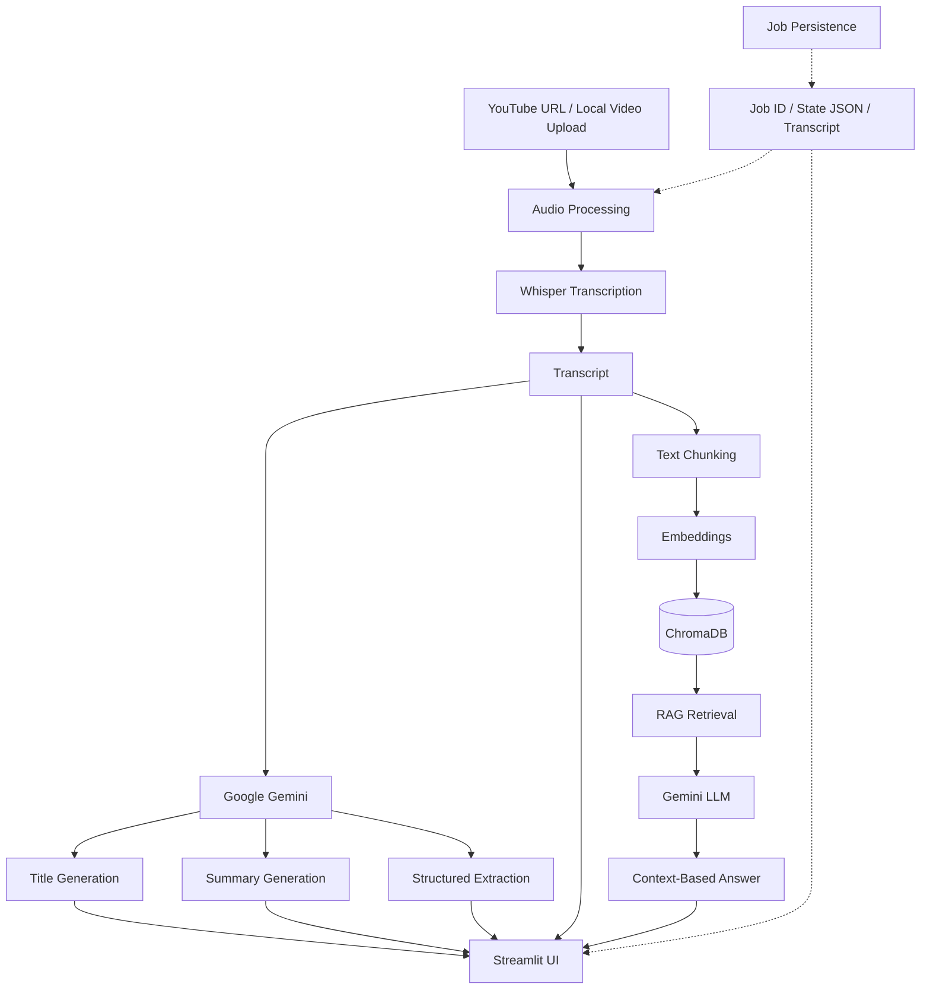

# 🎥 AI Video Assistant – Video Summarization & RAG-Based Q&A

An AI-powered application that transforms YouTube videos and local video files into searchable knowledge. It automatically transcribes video content, generates summaries, extracts important information, and allows users to ask questions about the video through a Retrieval-Augmented Generation (RAG) chatbot.

## 🚀 Project Overview

Watching long videos to find specific information can be time-consuming.

The **AI Video Assistant** solves this problem by automating video understanding using Generative AI and Retrieval-Augmented Generation (RAG).

Users can provide a YouTube URL or upload a local video file. The application processes the video, generates a transcript, creates an AI-powered summary, extracts structured insights, and stores transcript chunks in ChromaDB for contextual question answering.

## ✨ Key Features

- **YouTube Video Processing:** Process videos directly using YouTube URLs.
- **Local Video Upload:** Upload and process local video files.
- **Audio Processing:** Extract and convert audio using audio processing tools.
- **Speech-to-Text:** Generate transcripts using OpenAI Whisper.
- **AI Summarization:** Generate video titles and summaries using Google Gemini.
- **Structured Information Extraction:** Extract:
  - Action Items
  - Key Decisions
  - Open Questions
- **RAG-Based Chatbot:** Ask questions about the processed video and receive context-based answers.
- **Vector Database:** Store and retrieve transcript chunks using ChromaDB.
- **Job Persistence:** Save processing progress and results.
- **Resume Processing:** Continue failed or interrupted jobs without unnecessarily repeating completed stages.
- **Job-Based RAG Isolation:** Maintain separate vector collections for different video-processing jobs.

## 🏗️ System Architecture



## 🔄 Application Workflow

1. **Input:** User provides a YouTube URL or uploads a local video.
2. **Audio Processing:** Audio is downloaded or extracted and converted into a suitable format.
3. **Transcription:** Whisper converts audio into text.
4. **Title Generation:** Gemini generates a suitable video title.
5. **Summarization:** Gemini generates a concise summary of the transcript.
6. **Information Extraction:** Important action items, key decisions, and open questions are extracted.
7. **Text Chunking:** Transcript is divided into smaller chunks.
8. **Vector Storage:** Embeddings are generated and stored in ChromaDB.
9. **Question Answering:** Relevant chunks are retrieved to answer user questions using RAG.
10. **Persistence:** Job progress and results are saved so processing can resume after failures or interruptions.

## 🛠️ Tech Stack

| Technology | Purpose |
|---|---|
| Python | Backend development |
| Streamlit | User interface |
| OpenAI Whisper | Audio transcription |
| Google Gemini | Summarization, extraction and answer generation |
| LangChain | LLM and RAG integration |
| ChromaDB | Vector database |
| yt-dlp | YouTube audio/video downloading |
| FFmpeg / Audio Processing | Audio extraction and conversion |
| Python-dotenv | Environment variable management |

## 📁 Project Structure

```text
AI-Video-Assistant/
│
├── core/
│   ├── extractor.py
│   ├── job_store.py
│   ├── pipeline.py
│   ├── rag_engine.py
│   ├── summarize.py
│   ├── transcriber.py
│   └── vector_store.py
│
├── utils/
│   ├── app.py
│   ├── audio_processor.py
│   └── main.py
│
├── Requirements.txt
├── .gitignore
├── README.md
└── test.py
```

## ⚙️ Installation and Setup

### 1. Clone the Repository

```bash
git clone https://github.com/YADAV627/AI-Video-Assistant-.git
```

### 2. Navigate to the Project Directory

```bash
cd AI-Video-Assistant-
```

### 3. Create a Virtual Environment

```bash
python -m venv .venv
```

### 4. Activate the Virtual Environment

**Windows:**

```bash
.venv\Scripts\activate
```

### 5. Install Dependencies

```bash
pip install -r Requirements.txt
```

Install and configure FFmpeg if it is not already available on your system.

### 6. Configure Environment Variables

Create a `.env` file in the project root directory.

Add your Google Gemini API key:

```env
GOOGLE_API_KEY=your_google_api_key_here
```

Get an API key from [Google AI Studio](https://aistudio.google.com/).

**Important:** Never upload your actual `.env` file or API key to GitHub.

## ▶️ Run the Application

Start the Streamlit application:

```bash
python -m streamlit run utils/app.py
```

Open the local URL displayed in your terminal to access the application.

## 💾 Job Persistence and Resume Mechanism

The application implements a job-based persistence mechanism to manage video-processing tasks.

Each job maintains its own processing state and results.

**How it works:**

- Every video-processing task receives a unique Job ID.
- Processing progress is stored in a `state.json` file.
- Transcript data is stored separately.
- Completed stages are tracked.
- If a stage fails, the job can resume from the failed stage.
- Previously completed stages are not unnecessarily executed again.

This reduces repeated processing and improves reliability when external API calls fail or an application is interrupted.

## 🧠 Retrieval-Augmented Generation (RAG)

The project uses RAG to answer questions based on the processed video's transcript.

**RAG workflow:**

1. Split the transcript into smaller text chunks.
2. Generate embeddings for the chunks.
3. Store embeddings in ChromaDB.
4. Retrieve relevant chunks based on the user's question.
5. Pass retrieved context to the language model.
6. Generate a context-based answer.

### Job-Based RAG Isolation

Each processing job uses its own ChromaDB collection.

This prevents retrieval from mixing transcript chunks belonging to different video-processing jobs.

## 🔐 Security

- API keys are managed through environment variables.
- `.env` files are excluded using `.gitignore`.
- Virtual environments and generated processing data are excluded from version control.
- API credentials should never be committed to the repository.

## ⚠️ Current Limitations

- Processing time depends on video duration, audio quality, and available computing resources.
- External API availability and rate limits can affect processing.
- Very long videos may require significant memory and processing time.
- High-concurrency workloads have not yet been load-tested.
- The current application is designed as a prototype and is not yet optimized for large-scale production deployment.

## 🔮 Future Improvements

- Advanced RAG retrieval techniques.
- Hybrid Search and Reranking.
- Improved RAG evaluation.
- Background job processing and task queues.
- Better scalability for concurrent users.
- Advanced workflow orchestration using LangGraph.

## 🎯 Learning Outcomes

Through this project, I gained practical experience with:

- Generative AI application development.
- LLM API integration.
- Speech-to-text processing.
- Retrieval-Augmented Generation.
- Vector databases and embeddings.
- LangChain integration.
- Persistent job management and resume mechanisms.
- Building interactive AI applications using Streamlit.

## 👩‍💻 Author

**Rushika Yadav**

B.Tech – Artificial Intelligence and Machine Learning

GitHub: [YADAV627](https://github.com/YADAV627)

---

⭐ If you find this project interesting, consider giving it a star!
